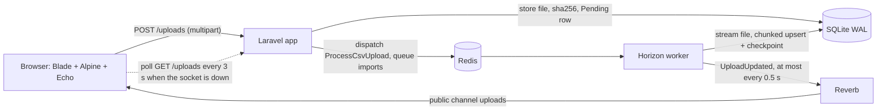

# YoPrint CSV Import

Upload a product CSV, a Horizon worker streams it into SQLite with bulk upserts keyed on `UNIQUE_KEY`, and a live list shows status, progress and inserted/updated/skipped counts.

<!-- TODO V: Loom link -->
<!-- TODO V: GIF -->


[](https://github.com/YOUR_GH_USER/yoprint-csv-import/actions/workflows/ci.yml)

Stack: PHP 8.3+ (the Docker image is 8.4), Laravel 13, SQLite (WAL), Redis 7 + Horizon, Reverb + Echo, Blade + Alpine + Tailwind v4, league/csv, Pest, Larastan level 6, Pint.

## Quick start (Docker)

```bash
git clone https://github.com/YOUR_GH_USER/yoprint-csv-import.git
cd yoprint-csv-import
docker compose up -d
# open http://localhost:8000
```

The first start installs Composer and npm packages, creates `.env` from `.env.example`, generates the key and migrates, so give it a minute or two (`docker compose logs -f app`). Services: app (8000), horizon, reverb (8080), vite (5173), redis.

Try it with generated data:

```bash
docker compose exec app composer demo                          # 10k dirty rows imported twice, prints a table
docker compose exec app php artisan products:generate-csv 10000 --dirty
# then drag storage/app/samples/products-10000-dirty.csv onto the page
```

`composer demo` empties the `products` table first so run 1 shows inserts.

### Without Docker

```bash
composer setup && composer dev
```

Needs PHP 8.3+ with `pdo_sqlite`, `intl` and `redis`, Composer, Node 22 and a local Redis (set `REDIS_HOST=127.0.0.1` in `.env`). `composer dev` runs the server, Horizon, Reverb and Vite together. Horizon needs `pcntl`, which is not available on native Windows PHP, so use WSL there. In `php.ini` set `upload_max_filesize=100M`, `post_max_size=110M` and `memory_limit=512M` (the Docker image ships these in `docker/php.ini`). The app accepts files up to `IMPORT_MAX_KB` (default 102400, i.e. 100 MiB).

## Architecture



## Reviewer's map

| Requirement | Code | Test |
|---|---|---|
| Upload endpoint: validation (missing, non-CSV, oversized), store, sha256, 202 + resource | `app/Http/Controllers/UploadController.php`, `app/Http/Requests/StoreUploadRequest.php`, `app/Http/Resources/UploadResource.php` | `tests/Feature/UploadApiTest.php` |
| List newest first, `limit`, same-file detection (`duplicate_of`) | `UploadController::index`, `UploadResource::withDuplicateOf` | `tests/Feature/UploadApiTest.php` |
| Streamed import, bulk upsert by `UNIQUE_KEY`, counts | `app/Jobs/ProcessCsvUpload.php`, `app/Imports/ProductCsv.php`, `app/Imports/ProductImportChunk.php` | `tests/Feature/ProcessCsvUploadTest.php` |
| Re-upload creates no duplicates (updated == rows, inserted 0) | same | `ProcessCsvUploadTest` ("counts every existing product as updated on re-upload"), `GenerateProductsCsvTest` (second run inserted 0) |
| Resume after a crash from the committed checkpoint | `ProcessCsvUpload::import`, `ProductImportChunk::commit` | `ProcessCsvUploadTest` ("resumes after the first committed chunk...") |
| Windows-1252 repaired, not deleted; BOM; control and zero-width characters | `app/Support/Utf8Sanitizer.php` | `tests/Unit/Utf8SanitizerTest.php`, `ProcessCsvUploadTest` ("maps a BOM header, repairs CP1252 bytes...") |
| Prices (`$1,234.50`, `abc` becomes null) | `app/Support/PriceParser.php` | `tests/Unit/PriceParserTest.php` |
| Blank key skipped with a sampled row error; duplicate key, last one wins | `ProductCsv::chunks` | `ProcessCsvUploadTest` |
| Missing `UNIQUE_KEY` header gives Failed with a message | `ProcessCsvUpload::import` | `ProcessCsvUploadTest` |
| Live updates, plus polling fallback | `app/Events/UploadUpdated.php`, `resources/js/uploads.js`, `resources/views/uploads/index.blade.php` | `tests/Feature/ProcessCsvUploadTest.php` (broadcast cases), `tests/Feature/HomePageTest.php`; the socket and polling behaviour was checked by hand in a browser, not by an automated test |
| Millisecond `duration_ms` | `app/Database/MillisecondSqliteConnection.php` | `tests/Feature/UploadDurationTest.php` |
| SQLite WAL + IMMEDIATE, retry_after > timeout | `config/database.php`, `config/queue.php` | `tests/Feature/ConfigTest.php` |
| Sample generator and demo | `app/Console/Commands/GenerateProductsCsv.php`, `app/Console/Commands/DemoImports.php` | `tests/Feature/GenerateProductsCsvTest.php` |
| CI (pint, phpstan, pest on PHP 8.3 and 8.4) | `.github/workflows/ci.yml` | n/a |

Run the checks in Docker: `docker compose exec app vendor/bin/pest`, `vendor/bin/pint --test`, `vendor/bin/phpstan analyse`.

## Design decisions

- **Streaming.** The job opens the stored file as a stream and reads records one at a time through league/csv. Rows are grouped into chunks of `IMPORT_CHUNK_SIZE` (default 1000, capped at 2978 so one upsert stays under SQLite's 32,766 bind parameters). Memory does not depend on file size.
- **Bulk upsert, not `updateOrCreate`.** One `INSERT ... ON CONFLICT DO UPDATE` per chunk instead of two queries per row. Before each upsert the chunk counts how many of its keys already exist (`whereIn(...)->count()`), which gives the inserted/updated split without relying on a driver-specific changes counter. A key repeated inside a chunk is folded to its last occurrence and counted as an update.
- **Resumable checkpoint, not replay.** Each chunk commits its products, row-error samples, totals and a `processed_offset` in one transaction. If a worker dies and Redis redelivers the job, it skips the committed records and carries on, so counts stay exact and no work is repeated. The checkpoint update is conditional on the expected offset, so a stale or duplicate worker cannot double-count.
- **Progress by bytes.** `progress` is the stream position over the file size (capped at 99 until completion), which stays accurate with quoted newlines and skipped rows. The resume checkpoint is a separate record count.
- **Convert, don't delete, bad UTF-8.** A cell that is not valid UTF-8 is converted from Windows-1252; only bytes still invalid afterwards are dropped. Example, a title that arrives as the raw bytes `54 65 65 20 AE`:

  | Approach | Stored value |
  |---|---|
  | Delete invalid bytes (`iconv //IGNORE`) | `Tee ` (the registered mark is lost) |
  | Convert from CP1252 (this app) | `Tee ®` (bytes `C2 AE`, covered by a byte-level test) |

- **Public broadcast channel.** The app has no users or login, so there is nobody to authorize. Events go to the public `uploads` channel and carry the same fields as the list API. A private channel would be the choice once auth exists. Broadcasting never blocks an import: `UploadUpdated` is `ShouldRescue`, and the Reverb client has `connect_timeout` 1 s and `timeout` 2 s, so a downed Reverb costs at most about 2 s per broadcast. The page then falls back to polling every 3 s.
- **SQLite: WAL + IMMEDIATE, and why PHP 8.4.** WAL lets the page read while the worker writes. Transactions begin `IMMEDIATE`, so the write lock is taken up front and a writer does not fail halfway after reading. Laravel only honours `transaction_mode` on PHP 8.4+, so the Docker image is PHP 8.4. CI also runs 8.3, where the import still works but transactions are deferred, and `ConfigTest` skips its 8.4 assertion.
- **`retry_after` 660 > job timeout 600.** Redis must not hand a job to a second worker while the first is still running. The job also uses `WithoutOverlapping` and a one-hour unique lock per upload.
- **Millisecond timestamps.** Laravel binds dates on SQLite as `Y-m-d H:i:s`, which made a sub-second import show `duration_ms` 0. A small SQLite connection class binds `Y-m-d H:i:s.v` instead.

## Production notes

- Set `APP_ENV=production` and `APP_DEBUG=false`.
- Generate the Reverb credentials (`REVERB_APP_KEY`, `REVERB_APP_SECRET`). The Docker entrypoint does this on first bootstrap; elsewhere use `openssl rand -hex 16`. Never ship the example values.
- Horizon is gated: the dashboard is reachable only when `APP_ENV=local` and denied everywhere else.
- Use a private broadcast channel per session instead of the public `uploads` channel once there is any notion of a user or session.
- Prune old uploads: stored files in `storage/app/private/uploads` and their `uploads` rows are kept forever, so schedule a cleanup.

## Benchmark

100,000 rows, a deliberately dirty file (BOM, CP1252 bytes, blank and duplicate keys, bad prices, control characters) with 900-byte padded descriptions: 101,327,648 bytes (96.6 MiB). Generated with `php artisan products:generate-csv 100000 --dirty --pad=900`.

Machine: Docker Desktop on Windows 11 (WSL2 kernel 6.6.87), AMD Ryzen 5 7500F (12 logical CPUs visible), 7.9 GB RAM visible to the container, PHP 8.4.28, SQLite on the container's volume.

| Run | Time | Peak memory (`memory_get_peak_usage`) | Result |
|---|---|---|---|
| CLI, `dispatchSync`, empty DB | 6.61 s | 38.0 MB allocated (33.4 MB used) | 97,011 inserted, 1,959 updated (duplicate keys in the file), 1,030 skipped |
| CLI, same file again | 6.72 s | 38.0 MB allocated (33.4 MB used) | 0 inserted, 98,970 updated, 1,030 skipped |
| HTTP `curl -F` POST /uploads, 100.96 MB clean padded file, to Completed | about 11 s total (3.9 s for the upload to return 202, then 6.7 s import) | n/a | 100,000 inserted |

Notes: each CLI run is a fresh process; broadcasting off. The HTTP run used PHP's built-in server and the `database` queue driver with `queue:work` on a separate SQLite file, not Redis/Horizon, and the total is the upload time plus the worker's reported `duration_ms` (6720 ms), with small polling and pickup overhead on top. The HTTP file is the clean variant, not the dirty one, for the reason below.

**Known issue found while benchmarking.** A file containing a control character such as `0x01` is detected by `finfo` as `application/octet-stream`, so `mimes:csv,txt` rejects it with a 422. The dirty sample from `--dirty` contains `0x01`, so it imports from the CLI and from `composer demo` but is rejected by `POST /uploads`. Other dirty content (BOM, CP1252 bytes, `0x07`) is detected as `text/csv` and passes. The validation rule was left unchanged.

## With more time

- tus or S3 presigned uploads so a 100 MB file does not go through PHP, with resumable uploads.
- `Bus::batch` to split one file across workers (SQLite's single writer would need Postgres or MySQL to benefit).
- Private channels once there is auth.
- Postgres or MySQL support (the upsert is portable; the SQLite pragmas are not).
- Meilisearch and a product browse/search page.
- A row-error download UI (errors are sampled, capped at 100 per upload, and not shown in the page yet).
- Relax or replace the `mimes` check so files with control characters are accepted and cleaned by the sanitizer.

## AI usage

This was built with AI assistance. Claude acted as project manager; GPT-6.2 Astra and Sol (via Codex) and Claude subagents wrote the code. Every change was tested and reviewed by the PM and by an independent reviewer. Claims in this README were checked against the code.
